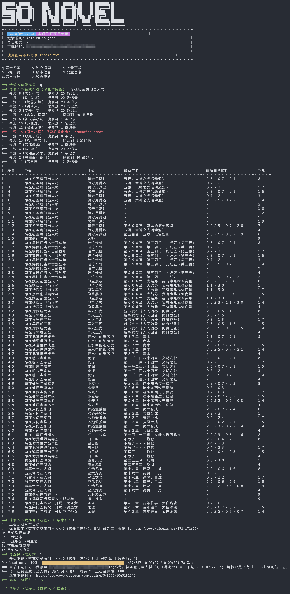
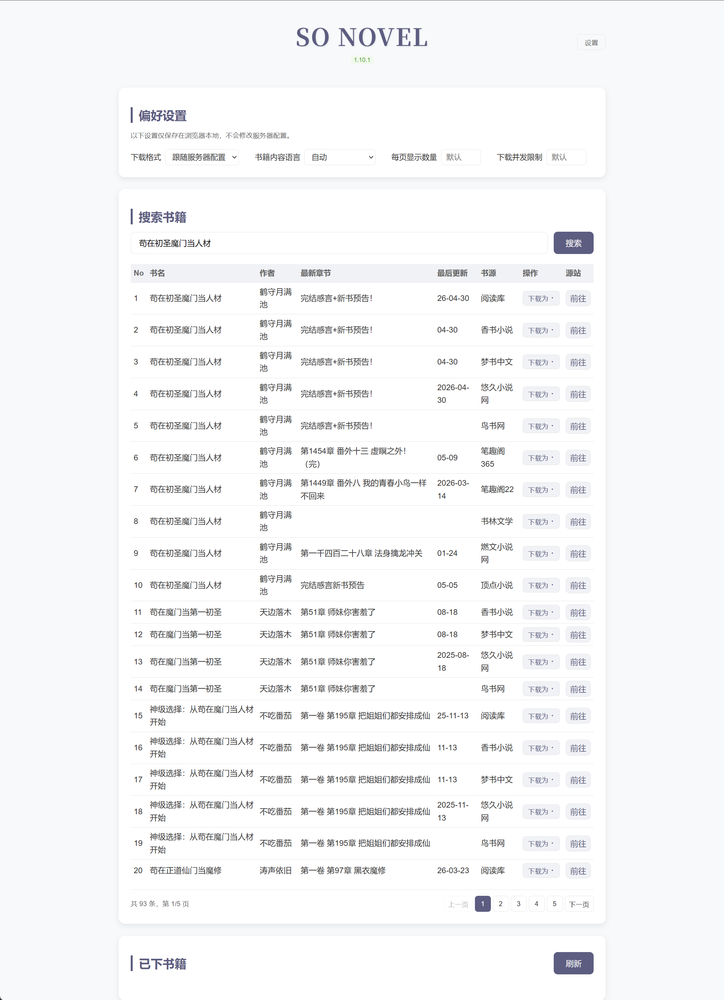
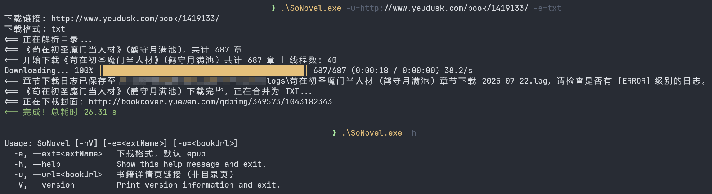

<div align="center">
  
  <h1 align="center">So Novel</h1>
  <h4 align="center"></h4>
</div>

<div align="center">

[![zread](https://img.shields.io/badge/Ask_Zread-_.svg?style=flat&color=00b0aa&labelColor=000000&logo=data%3Aimage%2Fsvg%2Bxml%3Bbase64%2CPHN2ZyB3aWR0aD0iMTYiIGhlaWdodD0iMTYiIHZpZXdCb3g9IjAgMCAxNiAxNiIgZmlsbD0ibm9uZSIgeG1sbnM9Imh0dHA6Ly93d3cudzMub3JnLzIwMDAvc3ZnIj4KPHBhdGggZD0iTTQuOTYxNTYgMS42MDAxSDIuMjQxNTZDMS44ODgxIDEuNjAwMSAxLjYwMTU2IDEuODg2NjQgMS42MDE1NiAyLjI0MDFWNC45NjAxQzEuNjAxNTYgNS4zMTM1NiAxLjg4ODEgNS42MDAxIDIuMjQxNTYgNS42MDAxSDQuOTYxNTZDNS4zMTUwMiA1LjYwMDEgNS42MDE1NiA1LjMxMzU2IDUuNjAxNTYgNC45NjAxVjIuMjQwMUM1LjYwMTU2IDEuODg2NjQgNS4zMTUwMiAxLjYwMDEgNC45NjE1NiAxLjYwMDFaIiBmaWxsPSIjZmZmIi8%2BCjxwYXRoIGQ9Ik00Ljk2MTU2IDEwLjM5OTlIMi4yNDE1NkMxLjg4ODEgMTAuMzk5OSAxLjYwMTU2IDEwLjY4NjQgMS42MDE1NiAxMS4wMzk5VjEzLjc1OTlDMS42MDE1NiAxNC4xMTM0IDEuODg4MSAxNC4zOTk5IDIuMjQxNTYgMTQuMzk5OUg0Ljk2MTU2QzUuMzE1MDIgMTQuMzk5OSA1LjYwMTU2IDE0LjExMzQgNS42MDE1NiAxMy43NTk5VjExLjAzOTlDNS42MDE1NiAxMC42ODY0IDUuMzE1MDIgMTAuMzk5OSA0Ljk2MTU2IDEwLjM5OTlaIiBmaWxsPSIjZmZmIi8%2BCjxwYXRoIGQ9Ik0xMy43NTg0IDEuNjAwMUgxMS4wMzg0QzEwLjY4NSAxLjYwMDEgMTAuMzk4NCAxLjg4NjY0IDEwLjM5ODQgMi4yNDAxVjQuOTYwMUMxMC4zOTg0IDUuMzEzNTYgMTAuNjg1IDUuNjAwMSAxMS4wMzg0IDUuNjAwMUgxMy43NTg0QzE0LjExMTkgNS42MDAxIDE0LjM5ODQgNS4zMTM1NiAxNC4zOTg0IDQuOTYwMVYyLjI0MDFDMTQuMzk4NCAxLjg4NjY0IDE0LjExMTkgMS42MDAxIDEzLjc1ODQgMS42MDAxWiIgZmlsbD0iI2ZmZiIvPgo8cGF0aCBkPSJNNCAxMkwxMiA0TDQgMTJaIiBmaWxsPSIjZmZmIi8%2BCjxwYXRoIGQ9Ik00IDEyTDEyIDQiIHN0cm9rZT0iI2ZmZiIgc3Ryb2tlLXdpZHRoPSIxLjUiIHN0cm9rZS1saW5lY2FwPSJyb3VuZCIvPgo8L3N2Zz4K&logoColor=ffffff)](https://zread.ai/freeok/so-novel)
[](https://github.com/freeok/so-novel/blob/main/LICENSE)
[](https://github.com/freeok/so-novel/releases/latest)
[](https://github.com/freeok/so-novel/releases/latest)

</div>

## 概述

**So Novel** 是一款通用的网页内容处理与导出工具，它致力于帮助用户高效地从网页中提取结构化信息，并将其灵活导出为
EPUB、TXT、PDF 等多种标准电子文档格式。适用于学习采集、格式转换、电子书制作等场景。

## 预览

<details>
  <summary>点击查看图片</summary>

### TUI 预览 (Text-based User Interface)



### WebUI 预览 (网页版)



### CLI 预览 (Command Line Interface)



</details>

## 安装

### 📦 手动下载压缩包

<https://github.com/freeok/so-novel/releases>

### 🪟 Windows

#### 1. PowerShell

```powershell
# powershell
irm https://raw.githubusercontent.com/freeok/so-novel/main/bin/windows-install.ps1 | iex
```

#### 2. CMD (命令提示符)

```cmd
powershell -NoProfile -ExecutionPolicy Bypass -Command "irm https://raw.githubusercontent.com/freeok/so-novel/main/bin/windows-install.ps1 | iex"
```

### 🐧 Linux

```bash
bash <(curl -sSL https://raw.githubusercontent.com/freeok/so-novel/main/bin/linux-install.sh)
```

### 🍺 Homebrew

```bash
brew tap ownia/homebrew-ownia
# https://docs.brew.sh/Tap-Trust#why-tap-trust-exists
brew trust --formula ownia/homebrew-ownia/so-novel
brew install so-novel
```

### 🍨 Scoop

```bash
scoop bucket add freeok https://github.com/freeok/scoop-bucket
scoop install freeok/so-novel
```

### 🐳 Docker

**方式 1: 脚本一键安装**

```bash
curl -sSL https://raw.githubusercontent.com/freeok/so-novel/main/bin/docker-install.sh | bash
```

**方式 2: Docker Compose (NAS 首选)**

```yaml
services:
  sonovel:
    image: ghcr.io/freeok/sonovel:latest
    container_name: sonovel
    ports:
      - "7765:7765"
    environment:
      JAVA_OPTS: "-Dmode=web"
    volumes:
      - sonovel_data:/sonovel
    restart: unless-stopped

volumes:
  sonovel_data:
```

**方式 3: Docker Run**

```bash
# 如需挂载，请提前准备好 config.ini 文件、rules 目录
docker run -d \
  --name sonovel \
  -v /sonovel/config.ini:/sonovel/config.ini \
  -v /sonovel/rules:/sonovel/rules \
  -v /sonovel/downloads:/sonovel/downloads \
  -p 7765:7765 \
  -e JAVA_OPTS='-Dmode=web' \
  ghcr.io/freeok/sonovel:latest
```

**从源码构建 Docker 镜像**

```bash
# 确保已安装 git、jdk 21、maven
sudo apt update
sudo apt install -y git
sudo apt install -y openjdk-21-jdk
sudo apt install -y maven

# 验证安装
git -v
javac -version
mvn -v

# 构建项目
git clone https://github.com/freeok/so-novel.git && cd so-novel
# arch: [x64|arm64]
sh bin/release-linux.sh [arch]

# 构建 Docker 镜像
cp -r target/sonovel-linux_[arch]/{app.jar,config.ini,rules} .
docker build -t sonovel .
```

> [!TIP]
>
> 为获得最佳阅读体验，建议使用以下电子书阅读器：
>
> **桌面端**
>
> - [Readest](https://readest.com/)
> - [Koodo Reader](https://www.koodoreader.com/zh)
> - [Calibre](https://calibre-ebook.com/)
> - [Neat Reader（网页版）](https://www.neat-reader.cn/webapp)
>
> **移动端**
>
> - [Readest](https://readest.com/)
> - [Apple Books](https://www.apple.com/apple-books/)
> - [Moon+ Reader（静读天下）](https://moondownload.com/chinese.html)
> - [Kindle](https://apps.apple.com/us/app/amazon-kindle/id302584613)
>
> 如需转换为其它电子书格式，可使用：
>
> - [FreeConvert](https://www.freeconvert.com/zh)
> - [Calibre](https://calibre-ebook.com/zh_CN)
>
> 修复 WPS、掌阅等软件无法打开 so-novel 下载的 EPUB：https://github.com/freeok/so-novel/discussions/199

## 自定义 JVM 系统属性

| 参数            | 说明                     | 默认值          |
|---------------|------------------------|--------------|
| -Dmode        | 启动模式，可选值：tui\|cli\|web | tui          |
| -Dconfig.file | 配置文件路径                 | ./config.ini |

用法

> [!NOTE]
>
> Windows 修改 [sonovel.l4j.ini](bundle/sonovel.l4j.ini)
>
> Linux 修改  [run-linux.sh](bundle/run-linux.sh)
>
> macOS 修改  [run-macos.sh](bundle/run-macos.sh)

## 使用本地 JDK / JRE 启动

如果你不想使用内置 JRE（runtime 目录），可以通过本地 JDK / JRE 启动程序

Windows 使用脚本 start-custom-jre.cmd：

```cmd
REM --------------------------------------------------
REM 高级用户使用自定义 JRE 启动程序
REM 将 "your_path\java.exe" 替换为你的 JRE 路径，例如：
REM "C:\Java\jdk-21\bin\java.exe"
REM --------------------------------------------------
@echo off
your_path\java.exe ^
  -XX:+UseZGC ^
  -XX:+ZGenerational ^
  -Dconfig.file=config.ini ^
  -Dmode=tui ^
  -Dfile.encoding=GBK|Big5 ^
  -jar app.jar
```

Linux / macOS：[run-linux.sh](bundle/run-linux.sh) / [run-macos.sh](bundle/run-macos.sh) 修改 java 路径

## AI 校对（错别字 + 乱码）

下载完成后（或针对已下载的成品书）可选地调用大模型修正错别字、同音误写，并清理乱码。默认**关闭**。

> [!WARNING]
>
> 开启后会把书籍正文发送给你配置的第三方 AI 服务。请先确认你接受该数据外发，并自行承担相应责任。

1. 在 `config.ini` 的 `[ai]` 段设置 `enabled = 1`
2. 提供密钥，优先级由高到低：环境变量 `SONOVEL_AI_KEY` → 启动参数 `-Dai.api-key` → `config.ini` 的 `api-key`
   （前两种可避免密钥明文落盘；WebUI 设置页里的密钥只会回显掩码，不修改时保持 `********` 即可）

### 方式一：内置预设（推荐，不用手填地址）

`provider` 选一个内置方案，程序自动补齐 `base-url` 与 `model`：

| provider              | 服务             | 模型                    |
|----------------------|------------------|-------------------------|
| `eac-qwen-cn`        | EAC router 千问国内版 | `qodercn/qfmodel`        |
| `eac-qwen-intl`      | EAC router 千问国际版 | `qoder/qfmodel`          |

EAC 预设的密钥从本机插件自己的配置文件读取（`~/.dsh/our-free-model/settings.json`，
可用 `eac-key-file` 改路径），**不需要你复制粘贴任何密钥**。前提是 DSH 的 Our Free Model 插件正在运行
（默认监听 `127.0.0.1:18326`）。

> [!IMPORTANT]
> - **国内版 `eac-qwen-cn`**：插件跑起来即可直接用。
> - **国际版 `eac-qwen-intl`**：需先在 Qoder 登录对应账号，否则网关会返回 502/503
>   （未登录或无可用上游）。登录前建议先用国内版。
> - 预设用 `qfmodel` 而非 `qmodel`：实测 `qmodel` 不遵守「关闭思考」参数，推理会吃掉
>   整个 `max-tokens` 导致正文被截断；`qfmodel` 才尊重该参数，token 与耗时都低一大截。

若插件没运行、连不上地址，或账号未登录/限流，校对会在命令行与审计日志里给出**中文原因 + 下一步建议**
（并保留网关原文便于排查），而不是甩一段看不懂的 JSON 或静默失败。

### 方式二：自定义 OpenAI 兼容服务

不选预设，直接填 `base-url`（需含 `/v1`）、`model`、`api-key`。
DeepSeek / 通义 / Kimi / 智谱 / OpenAI / Ollama / vLLM / LM Studio 等均兼容。

> [!NOTE]
> 预设**只补你没填的字段**：自己填过的 `base-url` / `model` 一律优先，
> 所以选了预设也还能混用自定义地址。

### 关于「模型思考」

校对是确定性任务，不需要推理链。`enable-thinking` 默认关 —— 实测开启时 reasoning tokens
占回复的 80%+，关掉后单次 token 降 3.8 倍、耗时降 2~3 倍。仅对内置预设服务发送该字段，
避免给不接受此参数的自定义服务添麻烦。

四种入口：

| 入口                | 说明                                              |
|-------------------|-------------------------------------------------|
| 下载流程内置            | 开启即在合并成品前校对章节缓存，txt/epub/pdf/html 自动带上结果         |
| TUI 菜单 `r`        | 校对已下载的成品书，写回前自动备份 `.proofread.bak`               |
| CLI               | `--proofread <文件或目录>`，可配 `--work-dir`             |
| WebUI             | 「已下载」列表点击校对按钮，异步执行并实时显示进度百分比                      |

为什么不会把「克莱恩」改成「克菜恩」这类专有名词改坏：

- **先理解再动手**：先用书名/作者去 Wikipedia、萌娘百科查条目摘要与站内链接，再叠加本书正文的高频专名统计，合成专有名词白名单一并交给模型；命中白名单的建议一律拒绝
- **模型只能提替换对**：AI 不返回改写后的全文，只能返回「原文片段 → 修正片段」，程序逐条校验（必须唯一命中、改动幅度受限、不得引入与本书简繁体系相悖的字形）通过后才落笔
- **乱码走确定性规则**：PUA 反爬字体、GBK/UTF-8 mojibake、调试残留等由本地规则修复，不消耗 token；还原后不可读就整条放弃
- **可复核**：每处改动与被拒绝的建议写进「书名 (作者) 校对记录.log」，任何异常都退化为保留原文

## 常见问题

https://github.com/freeok/so-novel/issues?q=label%3A%22usage%20question%22

## 讨论

https://github.com/freeok/so-novel/discussions?discussions_q=

## 支持 & 赞助

如果觉得有所帮助，欢迎扫码赞助☕、点击项目主页顶部的⭐Star 按钮支持！

🚀这将是我们持续更新的动力源泉！同时，你也能第一时间获取到最新的更新动态。💡❤️

| 支付宝赞助                                                           | 微信赞助                                                           |
|-----------------------------------------------------------------|----------------------------------------------------------------|
|  |  |

[项目赞助者列表](./SPONSORS.md)

## 免责声明

在使用本工具前，请务必仔细阅读我们的[法律免责声明](bundle/DISCLAIMER.md)。使用本工具即表示您已阅读、理解并同意遵守所有条款。

## Star History

[](https://www.star-history.com/?repos=freeok%2Fso-novel&type=date&legend=top-left)